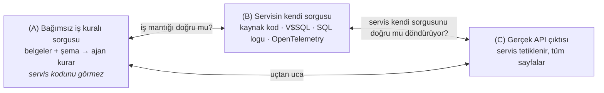
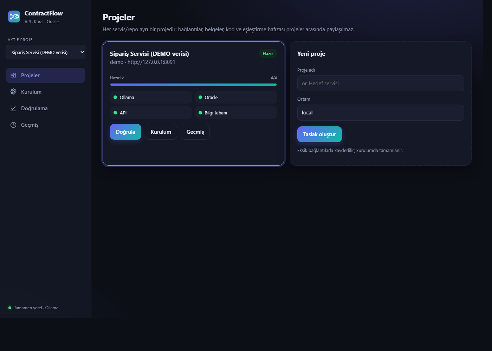
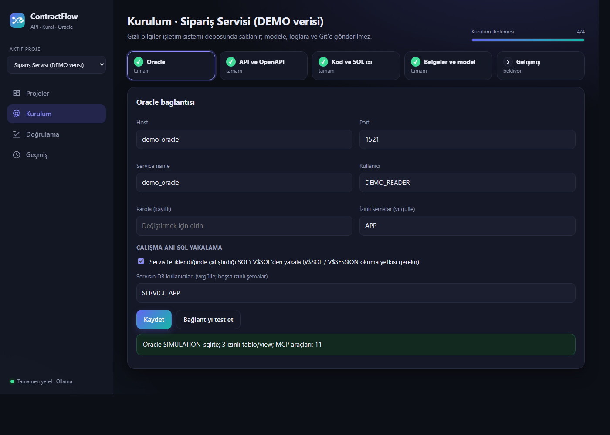
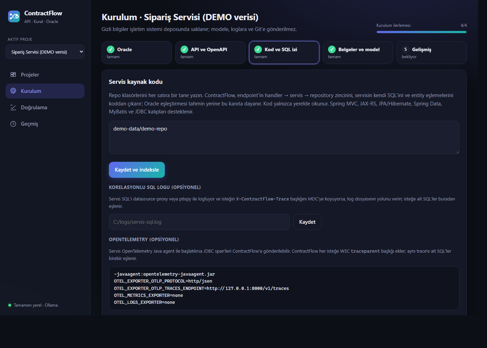
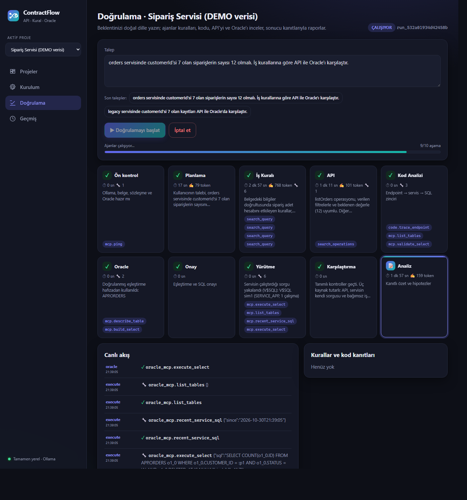
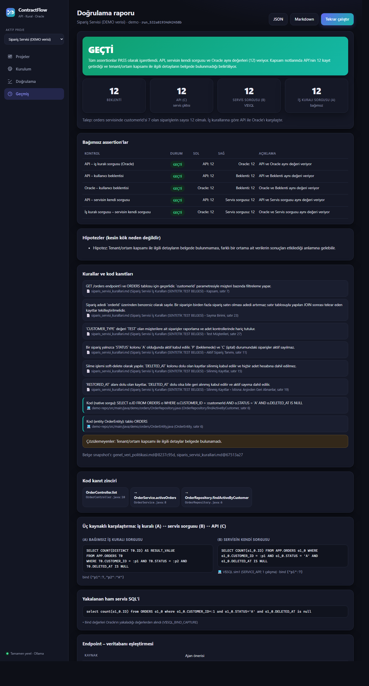
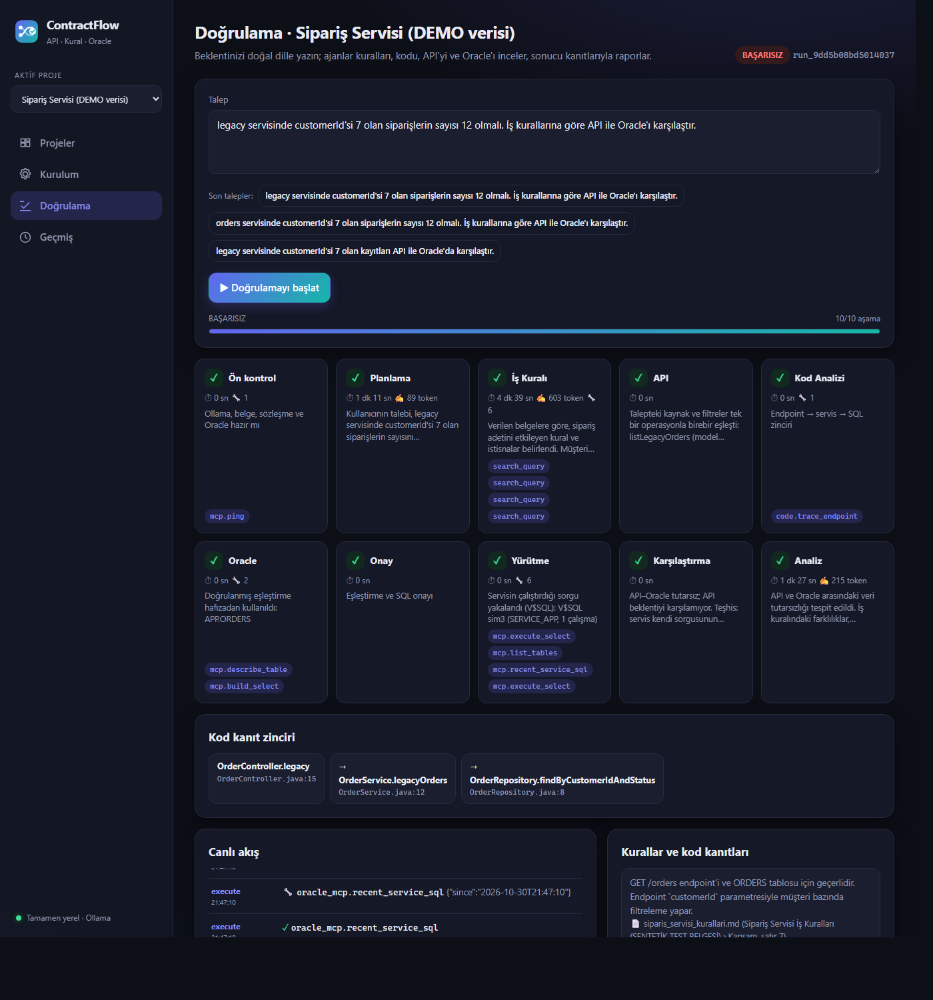
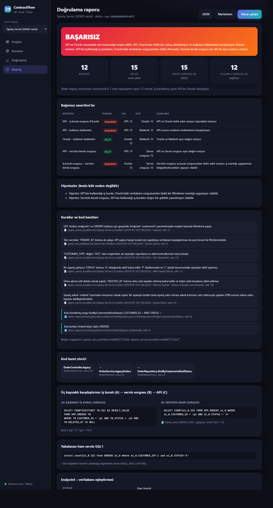
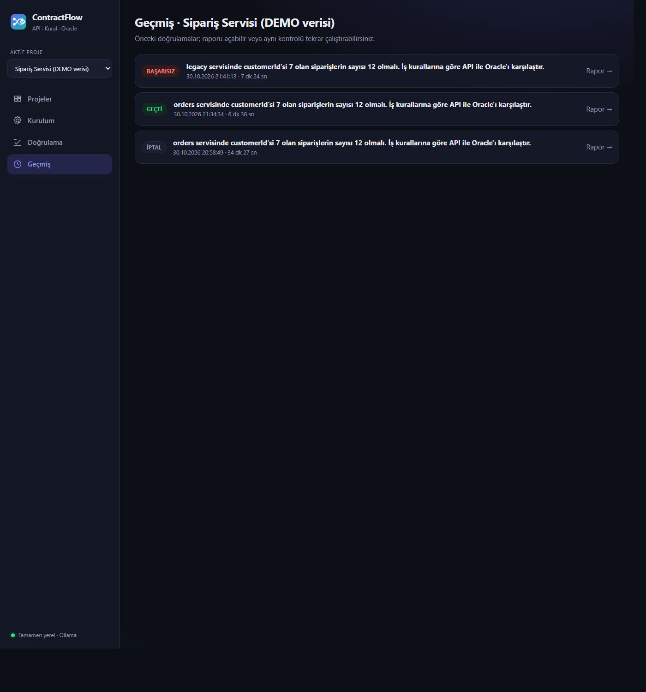
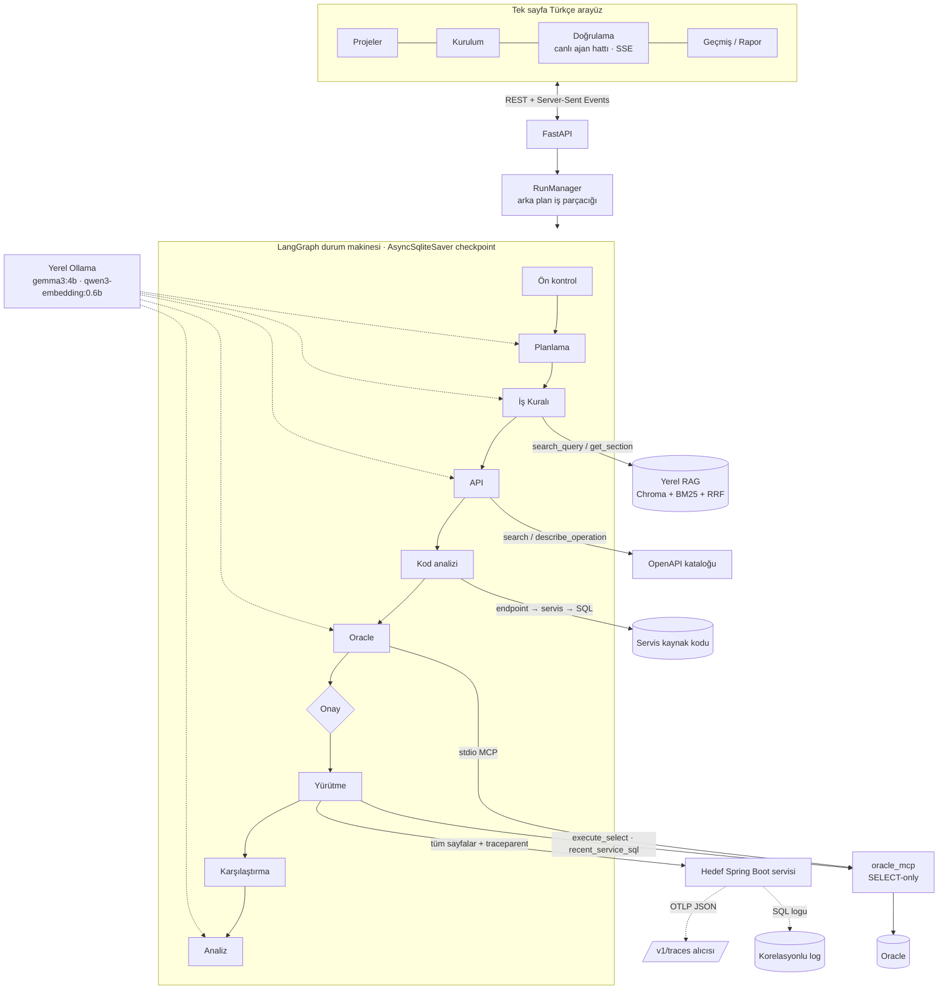

<p align="center"></p>

<h1 align="center">ContractFlow</h1>

<p align="center"><b>Java + Spring Boot servisinizin döndürdüğü veri, iş kuralının söylediğiyle ve Oracle'daki gerçekle tutarlı mı?</b><br>
Java / Spring Boot ile yazılmış REST servisleri için; doğal dille yazılan bir beklentiyi analist belgeleri, OpenAPI (Swagger) sözleşmesi, servisin Java kaynak kodu, gerçek API yanıtı ve Oracle verisi üzerinden doğrulayan, <b>tamamen yerel</b> çalışan multi-agent QA aracı.</p>

<p align="center">       </p>

<p align="center"><sub>Hedef: Java · Spring Boot (Spring MVC / Spring Data JPA / Hibernate / MyBatis / JDBC) · Oracle — Platform: Python · LangGraph · Ollama (gemma3:4b + qwen3-embedding:0.6b) · MCP · FastAPI</sub></p>

---

## İçindekiler

1. [Problem](#1-problem)
2. [Çözüm: üç kaynaklı doğrulama](#2-çözüm-üç-kaynaklı-doğrulama)
3. [Ekran görüntüleri](#3-ekran-görüntüleri)
4. [Mimari](#4-mimari)
5. [Ajanlar ve araçları](#5-ajanlar-ve-araçları)
6. [Servisin iş mantığını anlamak: kod analizi ve çalışma anı SQL yakalama](#6-servisin-iş-mantığını-anlamak)
7. [Güvenlik ve guardrail'ler](#7-güvenlik-ve-guardrailler)
8. [Teknolojiler ve seçim gerekçeleri](#8-teknolojiler-ve-seçim-gerekçeleri)
9. [Kurulum ve çalıştırma](#9-kurulum-ve-çalıştırma)
10. [Kullanım](#10-kullanım)
11. [Demo ortamı](#11-demo-ortamı)
12. [Testler ve değerlendirme](#12-testler-ve-değerlendirme)
13. [Sınırlamalar](#13-sınırlamalar)
14. [Proje yapısı](#14-proje-yapısı)

---

## 1. Problem

Spring Boot + Oracle servisleri geliştiren veya test eden ekipler, bir endpoint'in "doğru kayıtları" döndürüp döndürmediğini çoğunlukla elle kontrol eder:

1. Swagger'dan endpoint ve parametre bulunur.
2. Analist dokümanından "aktif kayıt", "silinmiş kayıt", "hariç tutulanlar" gibi kurallar okunur.
3. DBeaver'da hangi tablonun, hangi kolonun kullanıldığı tahmin edilir; SQL yazılır.
4. API'nin bütün sayfaları toplanır, sayılar karşılaştırılır.

Bu süreç yavaştır, kişiye bağlıdır ve sık hata üretir: Swagger tabloyu veya iş kuralını söylemez; ilk sayfanın kayıt sayısı toplam sanılır; JOIN çoğalması sayıyı şişirir; servisin hangi filtreyi uyguladığı ancak kod okunarak anlaşılır. Sonuçta "API ile DB farklı" denir ama **farkın nerede olduğu** bilinmez.

## 2. Çözüm: üç kaynaklı doğrulama

ContractFlow aynı soruyu **birbirinden bağımsız üç kaynağa** sorar ve farkın hangi katmanda olduğunu teşhis eder. Bu, yazılım testindeki *differential testing* (bağımsız uygulamaların aynı girdiyle karşılaştırılması) fikrinin bir REST servisi + veritabanı için uyarlanmasıdır.



| Fark | Teşhis |
|---|---|
| C = B, B ≠ A | Servis kendi sorgusunu doğru döndürüyor ama **sorgunun iş mantığı belgeden sapıyor** (ör. silinmiş kayıt filtresi unutulmuş). |
| C ≠ B, B = A | Sorgu doğru; **API çıktısı sorgudan farklı** (dönüşüm, mapping, sayfalama katmanı). |
| A = B = C | Üç kaynak tutarlı. |

Ayrıca kullanıcının yazdığı beklenti (ör. "25 olmalı") API ve iş kuralı sorgusuyla ayrı ayrı karşılaştırılır. Hüküm deterministik koddur; ajanlar araştırır ve önerir, **sonucu kod verir**.

Örnek talep:

> `orders servisinde customerId'si 7 olan siparişlerin sayısı 12 olmalı. İş kurallarına göre API ile Oracle'ı karşılaştır.`

## 3. Ekran görüntüleri

> Aşağıdaki görseller uygulamanın gerçek arayüzünden alınmıştır. Ajanlar (gerçek `gemma3:4b`), RAG, LangGraph akışı, stdio MCP sunucusu ve SELECT-only politika gerçektir; **veri ise demo verisidir**: Oracle yerine SQLite üzerinde çalışan simüle bir veritabanı, örnek bir sipariş servisi ve örnek bir Java repo'su kullanılmıştır ([Demo ortamı](#11-demo-ortamı)). Kurum içi gerçek sistem görüntüleri gizlilik nedeniyle paylaşılmamıştır.

### Projeler — her servis/repo ayrı proje, hazırlık durumu


### Kurulum — adım adım ilerleme, Oracle bağlantısı ve çalışma anı SQL yakalama


### Kurulum — servis kaynak kodu, korelasyonlu SQL logu ve OpenTelemetry


### Doğrulama — 10 aşamalı canlı ajan hattı (süre, token, araç çağrıları, akış)
Çalışma sürerken alınmıştır: Analiz ajanı çalışıyor; Yürütme kartı servisin SQL'inin V$SQL'den yakalandığını, Karşılaştırma kartı üç kaynağın tutarlı olduğunu gösteriyor.


### Sonuç — GEÇTİ: beklenti, API, servis sorgusu ve bağımsız iş kuralı sorgusu aynı (12)
Kurallar dosya/bölüm/satır kaynağıyla; kod kanıt zinciri (Controller → Service → Repository); (A) ve (B) sorguları yan yana.


### Doğrulama — iş mantığı hatası olan uç


### Sonuç — BAŞARISIZ ve teşhis: API 15 = servis sorgusu 15 ≠ iş kuralı sorgusu 12
Servis kendi sorgusunu doğru döndürüyor, ancak sorgu "silinmiş kayıtlar sayılmaz" kuralını uygulamıyor (`DELETED_AT IS NULL` eksik). Üçgenleme farkın iş mantığı katmanında olduğunu gösterir.


### Geçmiş


## 4. Mimari



**Akış:**

1. **Ön kontrol:** Ollama modelleri, belge indeksi, OpenAPI kataloğu ve Oracle (MCP `ping`) kontrol edilir. Eksik varsa çalışma bekleme durumuna geçer (`WAITING_FOR_OLLAMA`, `WAITING_FOR_DOCUMENTS`, …).
2. **Planlama:** Talep sınıflandırılır (doğrulama mı, sohbet mi), kaynak/filtre/beklenti çıkarılır. Talepte geçmeyen hiçbir değer kabul edilmez.
3. **İş Kuralı:** Belgelerde kavram bazlı hibrit arama; her kural dosya/bölüm/sayfa kaynağıyla.
4. **API:** Doğru GET operasyonu ve parametreler. Kaynak ve filtre tek bir operasyonla birebir eşleşiyorsa **LLM çağrılmadan** deterministik seçilir.
5. **Kod analizi:** Endpoint'in handler → servis → repository zinciri ve servisin kendi SQL'i koddan çıkarılır (B'nin statik kaynağı).
6. **Oracle:** Belgelerden ve şemadan **koddan bağımsız** iş kuralı sorgusu (A) kurulur. Yapılandırılmış plan MCP'de güvenli SQL'e derlenir.
7. **Onay:** İlk kullanımda (A) ve (B) yan yana kullanıcıya gösterilir; onaylanan eşleştirme proje hafızasına yazılır.
8. **Yürütme:** API'nin bütün sayfaları, (A) sorgusu ve (B) — kod, V$SQL, SQL logu veya OpenTelemetry'den — çalıştırılır.
9. **Karşılaştırma:** Beş bağımsız assertion ve üçgen teşhisi.
10. **Analiz:** Kanıtlı, kısa açıklama; hipotezler "Hipotez:" etiketiyle.

Ayrıntılar: [docs/architecture.md](docs/architecture.md)

## 5. Ajanlar ve araçları

| Ajan | Görev | Araçlar | Deterministik doğrulama |
|---|---|---|---|
| **Planlama** | Talebi sınıflandırır; kaynak, filtre, beklenti çıkarır | — | Değerler talepte birebir geçmeli; seçenekleri model değil katalog üretir |
| **İş Kuralı** | Aktiflik, silinme, sayma birimi, istisna ve kapsam kurallarını araştırır | `search_query`, `get_source`, `get_section` | Kaynağı bu çalışmada görülmemiş kural atılır |
| **API** | Okuma operasyonunu ve parametreleri seçer | `search_operations`, `describe_operation` | GET, katalogda tanımlı parametre, zorunlu header'lar, talepten gelen değer |
| **Oracle** | Bağımsız iş kuralı sorgusunu kurar | MCP: `search_schema`, `describe_table`, `get_relationships`, `build_select` | Kolonlar gerçek şemada; her filtre bir kurala bağlı ve değeri kural metninde geçiyor; her kural için karar zorunlu |
| **Sonuç Analizi** | Hesaplanmış sonucu açıklar | — | Durum ve sayılar değiştirilemez |

Ajanlar native tool-calling'e güvenmez: her adımda Ollama'nın JSON-schema kısıtlı üretimiyle üç ayrık aksiyondan biri (`tool_request` / `final` / `need_clarification`) üretilir, Pydantic ile doğrulanır ve yalnızca izinli LangChain araçları bir dispatcher üzerinden çağrılır. Kullanıcıya sunulan her seçenek gerçek bir kaynakta (OpenAPI kataloğu, incelenen şema) karşılığı olmalıdır; olmayanlar gösterilmez.

## 6. Servisin iş mantığını anlamak

"Servis kodun bir yerinde veritabanına gidip bir çıktı üretiyor; biz bu mantığa hakim olmalıyız." ContractFlow bunu dört generic yolla yapar ve hepsi aynı "servisin kendi sorgusu (B)" arayüzünü doldurur:

| Yol | Servis değişikliği | Nasıl çalışır |
|---|---|---|
| **Kaynak kod analizi** | Yok | Endpoint OpenAPI path'i koddaki route anotasyonlarında bulunur (Spring MVC, JAX-RS, sınıf+metot path birleşimi, sabitler). Çağrı zinciri 4 seviyeye kadar izlenir (interface → impl). Native/JPQL `@Query`, Spring Data `findBy…` metot adları, MyBatis XML (koşullu bloklar API parametresine göre), JDBC SQL'leri, `@Entity/@Table/@Column`, `@Where/@SQLRestriction` çıkarılır. Repoya özel hiçbir ad kodda yoktur. |
| **V$SQL ile çalışma anı yakalama** | Yok (yalnızca `V$SQL`/`V$SESSION` okuma yetkisi) | İstekten önce DB saati alınır; istekten sonra servisin DB kullanıcısının bu pencerede çalıştırdığı SELECT'ler okunur. ContractFlow'un kendi oturumu `MODULE='contractflow'` ile işaretlidir ve dışlanır. Bind değerleri `V$SQL_BIND_CAPTURE`'dan, yoksa API filtre sırasından eşlenir (raporda belirtilir). |
| **Korelasyonlu SQL logu** | Dev ortamında datasource-proxy/p6spy + MDC | Her isteğe `X-ContractFlow-Trace` başlığı eklenir; log dosyasında bu kimliği taşıyan SQL satırları alınır. |
| **OpenTelemetry** | Servis `-javaagent` ile başlatılır | Her isteğe W3C `traceparent` eklenir; servisin JDBC span'leri (`db.query.text`) ContractFlow'un `/v1/traces` alıcısına gelir ve aynı trace'e ait SQL birebir eşlenir. |

Yakalanan SQL'in sayfalama ve `ORDER BY` kısmı ayıklanır; `COUNT` sorgusu ise olduğu gibi, değilse `COUNT(*)` ile sarılarak **SELECT-only politikadan geçirilip** çalıştırılır.

**Bağımsızlık kuralı:** (A) iş kuralı sorgusunu kuran ajan, servisin SQL'ini ve koddan türetilen kuralları **görmez**; koddan yalnızca temel tablo adayları alınır. Aksi halde iki "bağımsız" uygulama aynı hatayı paylaşabilirdi.

## 7. Güvenlik ve guardrail'ler

- **SELECT-only `oracle_mcp`:** Resmi MCP Python SDK 2.x ile ayrı stdio süreci. Her `execute_select` çağrısında SQLGlot Oracle AST ile: tek ifade; DML/DDL/MERGE/`FOR UPDATE`/`SELECT INTO`/PL-SQL/`WITH FUNCTION` reddi; `DBMS_*` gibi paket çağrıları ve izin dışı fonksiyonlar reddi; DB link, şemasız tablo, izin dışı şema, CTE gölgeleme kontrolü; tablo/kolonların gerçek metadata'ya karşı doğrulanması; isimli bind zorunluluğu; `SET TRANSACTION READ ONLY`, zaman aşımı, satır/byte limiti.
- **Gizli bilgiler:** Parola, token ve sabit header değerleri yalnızca `SecretReference` olarak saklanır; değerler işletim sistemi anahtar deposunda (Windows Credential Manager / Keychain), yoksa Fernet ile şifreli dosyada durur. Modele, RAG'e, checkpoint'e, olay günlüğüne, rapora ve Git'e girmez. MCP sunucusu parolayı süreç argümanından değil depodan okur.
- **HTTP:** Yalnızca kurulumda doğrulanan base URL'ye gidilir (Swagger `servers` yetkili sayılmaz), yönlendirme takip edilmez, curl çıktısı `$CONTRACTFLOW_TOKEN` gibi yer tutucularla gösterilir.
- **Model:** Kaynaksız kural, şemada olmayan kolon, talepte geçmeyen değer ve uydurma seçenekler deterministik kapılarda reddedilir. Konu dışı talepler araç çağrılmadan kapatılır. Model çağrıları süre sınırlıdır; asılı kalan çağrı akışı kilitlemez.
- Uygulama yalnızca `127.0.0.1`'e bind olur.

## 8. Teknolojiler ve seçim gerekçeleri

| Teknoloji | Gerekçe |
|---|---|
| **LangGraph** + LangChain Core | Koşullu kenarlar, `interrupt`/`Command(resume)`, kalıcı SQLite checkpoint; uygulama yeniden başlasa da çalışma sürer |
| **Ollama** · `gemma3:4b` | Tamamen yerel karar modeli; JSON-schema ile kısıtlı üretim |
| **Ollama** · `qwen3-embedding:0.6b` | Yerel, Türkçe destekli, instruction-aware sorgu biçimi, 1024 boyut |
| **Chroma** + **rank-bm25** + RRF | Diskte yerel vektör deposu; `customerId`, `DELETED_AT` gibi tam adlar için kelime araması |
| **MCP Python SDK 2.x** | Oracle erişimini ayrı süreçte, standart protokolle ve araç keşfiyle izole eder |
| **python-oracledb** (Thin) | Oracle Client kurulumu gerektirmez |
| **SQLGlot** | SQL'i AST seviyesinde denetlemek ve yakalanan SQL'i güvenle dönüştürmek için |
| **FastAPI** + SSE + vanilla JS | Ayrı frontend derlemesi gerektirmeyen, canlı akışlı tek sayfa arayüz |
| **httpx**, **Pydantic**, **keyring/cryptography** | Async HTTP ve ayrıntılı hata sınıfları; tipli modeller; gizli bilgi deposu |

## 9. Kurulum ve çalıştırma

Docker gerekmez. Ayrıntılı rehber: [docs/setup.md](docs/setup.md)

```bash
cd contractflow
python -m pip install -r requirements.lock
ollama pull gemma3:4b
ollama pull qwen3-embedding:0.6b
python scripts/doctor.py          # bağımlılık ve model kontrolü
python -m app.main                # http://127.0.0.1:8000
```

Gerçek bağlantılarla smoke testi (kurulumdan sonra): `python scripts/smoke.py <proje_id>`

## 10. Kullanım

1. **Projeler:** Her servis/repo için ayrı proje (taslak olarak da kaydedilir).
2. **Kurulum** (adım adım, ilerleme çubuğuyla):
   - **Oracle:** host, port, service name, kullanıcı, parola, izinli şemalar → *Bağlantıyı test et*. İsteğe bağlı: *Çalışma anı SQL yakalama* ve servisin DB kullanıcıları.
   - **API ve OpenAPI:** base URL, kimlik doğrulama, *sabit header'lar* (anahtar–değer; `{uuid}` her istekte yeni UUID) → *Servisi kontrol et*; Swagger/OpenAPI yükleme.
   - **Kod ve SQL izi:** repo klasörleri; isteğe bağlı SQL log yolu ve OpenTelemetry ayarı.
   - **Belgeler ve model:** PDF/MD iş kuralı belgeleri (ya da *belge zorunlu değil*), model ayarları ve gerçek model yetenek testi.
3. **Doğrulama:** Talebi yazın, *Doğrulamayı başlat*. 10 aşamalı ajan hattını canlı izleyin: her kartta durum, süre, tahmini süre, üretilen token, akan kısa gerekçe ve araç çağrıları. İlk kullanımda (A) ve (B) sorguları yan yana onayınıza sunulur.
4. **Sonuç ve geçmiş:** Durum, dört metrik (Beklenti · API · Servis sorgusu · İş kuralı sorgusu), teşhis, kod kanıt zinciri, maskeli curl, SQL ve bind'lar, kapsam notları; JSON/Markdown indirme; aynı kontrolü tekrar çalıştırma.

## 11. Demo ortamı

Gerçek sisteme bağlanmadan arayüzü ve ajanları denemek için (veriler **demo verisidir**):

```bash
python scripts/demo_environment.py serve --data demo-data   # uygulama :8020, örnek servis :8091
python scripts/demo_environment.py drive                    # iki senaryoyu gerçek ajanlarla çalıştırır
```

Demo projesi, iki uç için önceden onaylanmış iş kuralı eşleştirmesiyle (proje hafızası) başlar; böylece CPU'da uzun süren Oracle ajanı adımı atlanır ve bir senaryo birkaç dakikada tamamlanır. Demo; SQLite üzerinde simüle bir "Oracle", Spring Page döndüren örnek bir sipariş servisi (doğru `/orders` ve silinme filtresini unutan `/orders/legacy` ucu), bu servisin örnek Java kaynak kodu ve sentetik iş kuralı belgelerinden oluşur. Simüle servis çalıştırdığı SQL'i bir `V$SQL` benzeri tabloya yazar; böylece çalışma anı yakalama da gösterilebilir.

## 12. Testler ve değerlendirme

```bash
python -m pytest tests/unit tests/integration -q
python -m pytest tests/e2e -s -q          # gerçek Ollama gerektirir
```

| Kapsam | Sonuç |
|---|---|
| Karşılaştırma motoru (5 assertion, üçgen teşhisi, eksik kanıt, Decimal) | ✅ |
| SELECT-only politika: 20 desteklenen yapı, 23 reddedilmesi gereken sorgu | ✅ |
| Gerçek stdio MCP: araç keşfi, sunucu tarafı politika, hata sınıfları, parola sızıntısı yok | ✅ |
| Kod analizi: route/constant, interface→impl, native/JPQL/MyBatis/derived, entity eşlemesi | ✅ |
| Çalışma anı yakalama: V$SQL (simüle), OTLP JSON, korelasyonlu log, Hibernate sayfalı SQL dönüşümü | ✅ |
| RAG (gerçek `qwen3-embedding:0.6b`): 14 Türkçe soruda hit@4 = 1.00, MRR = 0.893 | ✅ |
| Web: tek sayfa, SSE, gizli bilginin yanıtta/DB'de olmaması, OTLP alıcısı | ✅ |
| Gerçek Oracle 19c bağlantısı, şema keşfi, gerçek servis çağrısı (kurum içi ortam) | ✅ elle doğrulandı |

Ayrıntılar ve gerçek/simüle ayrımı: [docs/evaluation.md](docs/evaluation.md)

## 13. Sınırlamalar

- `gemma3:4b` küçük bir modeldir ve yalnızca CPU'da ajan başına 30 sn–3 dk sürebilir. Bu yüzden ağır işler (kod analizi, SQL dönüşümü, karşılaştırma) deterministiktir; tekrar çalışmalarda proje hafızası LLM çağrılarını azaltır.
- Kod analizi derleyici değil, kalıp ve sembol aramasıdır; reflection, çok dinamik `Criteria` sorguları ve stored procedure'ler tam çözülemez (stored procedure raporda işaretlenir). Bu durumda V$SQL/OTel yolları önerilir.
- V$SQL yakalama paylaşılan ortamda başka kullanıcıların sorgularını da görebilir; dev/test ortamı ve servise özel DB kullanıcısı önerilir.
- İlk sürüm adet doğrulaması ve GET operasyonları içindir; alan bazlı karşılaştırma, otomatik OAuth akışı ve yerel OCR kapsam dışıdır.

## 14. Proje yapısı

```text
contractflow/
  app/
    agents/          ajan rolleri, structured-action, dispatcher, grounding, runtime
    orchestration/   LangGraph akışı, RunManager
    code/            kod analizi, SQL dönüşümü, çalışma anı yakalama (V$SQL/log/OTel)
    connectors/      http (executor, curl), openapi (parser), oracle_mcp (stdio client)
    adapters/        spring_boot (yanıt zarfı ve sayfalama algılama)
    rag/             loader, chunker, tokenizer, embeddings, BM25, Chroma, indexer
    core/            domain modelleri, karşılaştırma motoru, rapor
    persistence/     SQLite repository'leri
    secrets/         keyring / şifreli dosya, maskeleme
    services/        container, kurulum servisi
    api/, ui/        FastAPI route'ları, SSE, tek sayfa arayüz (HTML/CSS/JS, logo)
  oracle_mcp/        SELECT-only MCP sunucusu, politika, SQL derleyici
  prompts/           sürümlü ajan prompt'ları
  scripts/           doctor, smoke, demo_environment, capture_screenshots
  tests/             unit, integration, e2e, evaluation, support (simülasyon ve demo)
  docs/              mimari, kurulum, kullanım, sorun giderme, değerlendirme, ekran görüntüleri
```
