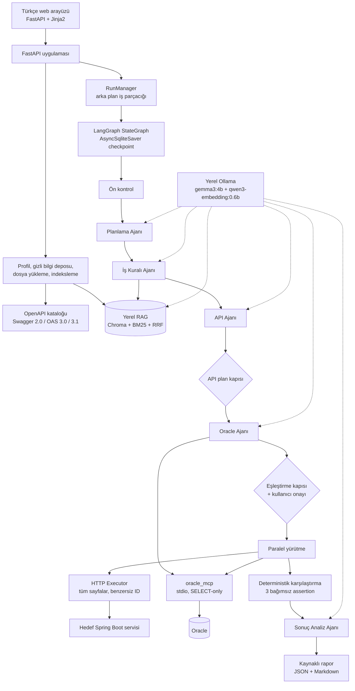
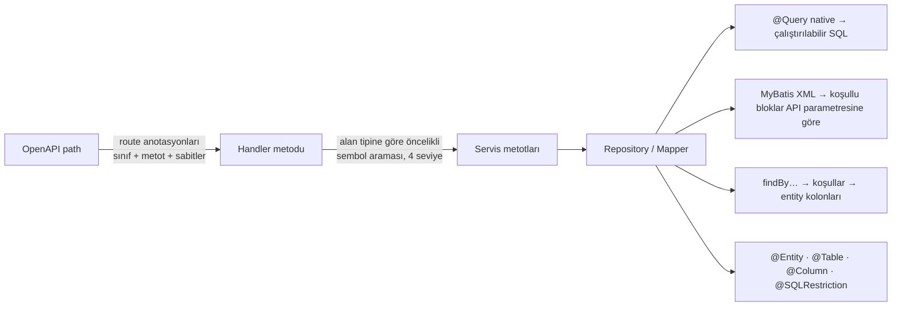
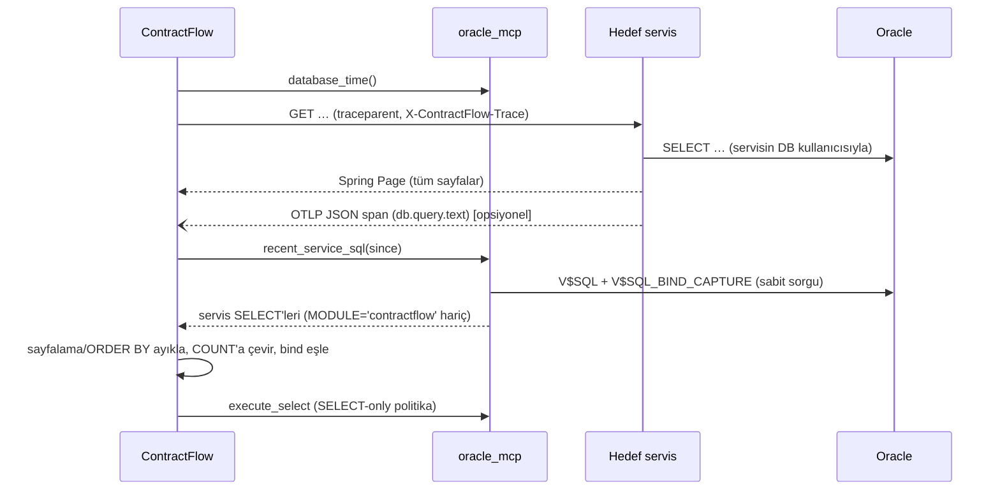

# ContractFlow mimarisi

## Genel akış

## Neden agent?

Bir sayı karşılaştırması tek bir SQL ve tek bir HTTP çağrısı gibi görünse de aradaki boşluğu insanlar doldurur: hangi endpoint, hangi parametre, hangi tablo, hangi kolon, "aktif" ne demek, silinmiş kayıtlar sayılır mı, istisna nedir, sayfalama nasıl. Bu bilgiler Swagger'da yoktur; analist dokümanlarına ve şema açıklamalarına dağılmıştır. ContractFlow bu araştırmayı ajanlara yaptırır, ancak **hükmü ajanlara bırakmaz**: SQL derleme, politika denetimi, sayfalama, sayım ve karşılaştırma deterministik koddur.

## Beş ajan

| Ajan | Girdi | Araçlar | Çıktı | Deterministik doğrulama |
|---|---|---|---|---|
| Planlama | Kullanıcı talebi, katalogdaki kaynaklar | — | `VerificationIntent` | Filtre değeri ve beklenen sayı talepte birebir geçmeli |
| İş Kuralı | Niyet, ön arama sonuçları | `search_query`, `get_source`, `get_section` | `BusinessRuleBundle` | Her kuralın kaynak chunk'ı bu çalışmada görülmüş olmalı; aksi halde atılır |
| API | Niyet, aday operasyonlar | `search_operations`, `describe_operation` | Operasyon + parametreler | GET + yürütülebilir; parametre katalogda tanımlı; değerler talepten; zorunlu parametreler dolu |
| Oracle | Niyet, kurallar, aday tablolar | `search_schema`, `describe_table`, `get_relationships` (MCP) | Yapılandırılmış eşleştirme | Kolonlar şemada; her filtre bir kurala bağlı ve değeri kural metninde geçiyor; her kural için karar zorunlu; SQL MCP'de derlenip doğrulanır |
| Sonuç Analizi | Hesaplanmış assertion'lar | — | Özet + etiketli hipotezler | Durum ve sayılar değiştirilemez; hipotezler "Hipotez:" önekiyle |

Ajanlar aynı yerel modeli (gemma3:4b) farklı prompt dosyası, araç yetkisi ve çıktı şemasıyla kullanır. Model eşzamanlılığı 1'dir.

## Structured-action yürütme

Native tool-calling varsayılmaz. Her adımda model, Ollama'nın JSON-schema `format` desteğiyle üç ayrık aksiyondan birini üretir:

- `tool_request` — `tool` alanı izinli araç adlarından biri (`const`), `arguments` o aracın Pydantic şeması
- `final` — rolün çıktı şeması
- `need_clarification` — soru + seçenekler

Çıktı ayrıca Pydantic ile doğrulanır (fazla alan, yanlış araç adı, eksik argüman reddedilir). Geçersiz çıktıda bir kez düzeltme istenir; ikinci başarısızlık `MODEL_OUTPUT_INVALID` olur. Araçlar LangChain `StructuredTool` olarak tanımlıdır ve yalnızca `ToolDispatcher` üzerinden çağrılır. Ajan başına adım ve çalışma başına model çağrısı limiti vardır.

## LangGraph durum makinesi

Düğümler: `preflight → planner → rules → api → oracle → gate → execute → compare → analyst → report`, ayrıca `wait`.

- Her düğüm sonrası koşullu kenar: bekleme durumları → `wait`, `ERROR`/`CANCELLED` → `report`, plan kapısı reddi → aynı düğüm (geri bildirimle, en fazla 2 deneme).
- `wait` düğümü `interrupt()` ile durur; kullanıcı yanıtı `Command(resume=...)` ile verilir.
- Checkpoint'ler `AsyncSqliteSaver` ile `data/checkpoints.sqlite3` içinde kalıcıdır; uygulama yeniden başlarsa `RUNNING` çalışmalar son checkpoint'ten sürdürülür.
- Tamamlanmış HTTP ve DB gözlemleri `operation_results` tablosunda idempotency anahtarıyla saklanır; replay sırasında yeniden çalıştırılmaz.

Durumlar: `RUNNING`, `WAITING_FOR_DOCUMENTS`, `WAITING_FOR_OLLAMA`, `WAITING_FOR_SERVICE`, `AUTH_REQUIRED`, `NEEDS_CLARIFICATION`, `PASS`, `FAIL`, `INCONCLUSIVE`, `ERROR`, `CANCELLED` (profil düzeyinde `DRAFT`/`READY`).

## Hafıza

- **Kısa süreli:** çalışma checkpoint'i (LangGraph state).
- **Kalıcı proje hafızası:** kullanıcının onayladığı endpoint–tablo eşleştirmeleri (`mappings` tablosu, OpenAPI özetine bağlı). Sonraki çalışmalarda Oracle ajanı yerine bu eşleştirme kullanılır, ancak şema yeniden doğrulanır. Eski API/DB değerleri hafızaya alınmaz.

## SELECT-only oracle_mcp

Resmi MCP Python SDK 2.x (`MCPServer`) ile yazılmış ayrı bir stdio süreci. Uygulama her çalışma için proje bağlantı bilgisiyle yeni bir süreç başlatır; parola süreç argümanına veya ortam değişkenine konmaz, sunucu gizli bilgi deposundan referansla okur.

Her `execute_select` çağrısında sunucu içinde:

1. SQLGlot Oracle AST ile tek ifade, kök SELECT/UNION kontrolü
2. Yasak düğümler: DML, DDL, MERGE, `FOR UPDATE`, `SELECT INTO`, transaction komutları, ayrıştırılamayan PL/SQL ve `WITH FUNCTION`
3. Token düzeyinde `paket.fonksiyon(` çağrıları (ör. `DBMS_*`), izin listesi dışı fonksiyonlar ve UDF'ler
4. DB link (`@`), şemasız tablo, allowlist dışı şema, CTE alias'ıyla gölgeleme
5. Tablo ve kolonların gerçek şema metadata'sına karşı doğrulanması
6. İsimli bind parametreleri ile birebir eşleşme
7. `SET TRANSACTION READ ONLY`, `call_timeout`, satır ve byte limiti, sonuçta `truncated`

## RAG

- PDF (pypdf; sayfa no + numaralı/büyük harf başlık hiyerarşisi) ve Markdown (başlık yolu, satır aralığı, liste/tablo/kod blokları)
- Bölüm sınırını koruyan chunker; boyutlar **gerçek Qwen3 tokenizer'ı** ile ölçülür. Tokenizer, Ollama'daki modelin kendi BPE sözlüğünden yerelde kurulur ve Ollama'nın `prompt_eval_count` değeriyle birebir doğrulanmıştır.
- Embedding: `qwen3-embedding:0.6b`, 1024 boyut doğrulanır; sorgular `Instruct: …\nQuery: …` biçiminde, belgeler önek olmadan
- Chroma `PersistentClient` (embedding fonksiyonu yok, vektörler bizden) + Türkçe/camelCase duyarlı BM25Plus + Reciprocal Rank Fusion
- İndeks nesli: model/digest/boyut değişirse yeni nesil oluşturulur ve atomik olarak aktifleştirilir
- Aynı dosyanın yeni sürümü yüklendiğinde eski sürüm `superseded` olur; çalışmalar başlangıçtaki belge snapshot'ını kullanır

## Genişleme noktaları

| Arayüz | İlk uygulama | Yeni ekleme |
|---|---|---|
| `BackendFrameworkAdapter` | `SpringBootAdapter` (Page/HAL, page/size) | Başka framework'ün yanıt zarfı |
| `DatabaseConnector` | `OracleMcpConnector` | Başka bir MCP sunucusu |
| `ModelProvider` | `OllamaModelProvider` | Native tool-calling sağlayıcısı |
| `DocumentLoader` | PDF, Markdown | DOCX, Confluence dışa aktarımı |
| `RetrievalStore` | Chroma + BM25 | Başka yerel vektör deposu |

## Üç kaynaklı doğrulama (differential testing)

ContractFlow aynı adedi birbirinden bağımsız üç kaynaktan ölçer:

| Kaynak | Nasıl elde edilir | Bağımsızlık |
|---|---|---|
| **(A) İş kuralı sorgusu** | Oracle ajanı belgelerdeki kurallar ve gerçek şemadan yapılandırılmış plan üretir; MCP `build_select` güvenli SQL'e derler | Servisin SQL'ini ve kod kurallarını **görmez**; koddan yalnızca temel tablo adayları alır |
| **(B) Servisin kendi sorgusu** | Öncelik sırasıyla: OpenTelemetry trace'i → korelasyonlu SQL logu → `V$SQL` zaman penceresi → statik kod analizi | Servisin gerçek uygulamasıdır |
| **(C) API çıktısı** | Servis tetiklenir, bütün sayfalar toplanır, benzersiz ID sayılır | Kullanıcının gördüğü sonuçtur |

Beş assertion üretilir: API–(A), API–beklenti, (A)–beklenti, API–(B), (A)–(B). Üçgen teşhisi farkın katmanını söyler: `C=B, B≠A` → iş mantığı/filtre farkı; `C≠B, B=A` → dönüşüm/mapping/sayfalama farkı.

## Kod analizi (generic)

Derleyici gerektirmez, build aracından bağımsızdır; repoya özel ad içermez. Koddan çıkan her tablo ve kolon MCP ile gerçek şemada doğrulanır. Kodun çözemediği dinamik kalıplarda servisin gerçek SQL'i çalışma anında (V$SQL, SQL logu, OpenTelemetry) yakalanır.

## Çalışma anı SQL yakalama

`recent_service_sql` ve `database_time` sabit sorgulu, parametreleri doğrulanan salt-okunur araçlardır; genel SQL politikası bunlar için gevşetilmez.

## Canlı izleme

Olaylar SQLite'a yazılır ve `/api/runs/{id}/stream` Server-Sent Events ucu ile anında arayüze akar. Model yanıtı akış olarak alınır; ajan kartında üretilen token sayısı ve aksiyon JSON'undaki kısa `reason` alanı yazıldıkça gösterilir (iç düşünce zinciri gösterilmez). Geçmiş çalışmaların aşama süreleri ortalanarak her kart için tahmini süre ve toplam kalan süre hesaplanır.
